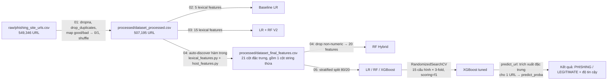

# Phân tích ML Pipeline: Hệ thống phát hiện Phishing URL

> **Phạm vi:** Toàn bộ mã nguồn trong [src/features/](src/features/), 5 notebook trong [notebooks/](notebooks/), dữ liệu trong [data/](data/) và [README.md](README.md).
> **Phương pháp:** (1) Đọc mã nguồn và output đã lưu của từng cell; (2) **tái lập độc lập** thí nghiệm với cùng `random_state=42` để có các số liệu mà notebook không in ra dạng văn bản (confusion matrix dạng số, điểm trên tập train, ROC-AUC/PR-AUC, feature importance, phân tích lỗi, kiểm tra rò rỉ dữ liệu).
> **Quy ước:** Số liệu đánh dấu 📓 lấy trực tiếp từ output notebook. Số liệu đánh dấu 🔬 là do tái lập (scikit-learn 1.9.0, XGBoost 3.4.1). Kết quả tái lập khớp với notebook (ví dụ RF: Accuracy 0.9255 / F1 0.8261 ở cả hai bên).

---

## Tóm tắt điều hành (Executive Summary)

| Hạng mục | Kết luận |
|---|---|
| **Mô hình tốt nhất** | Theo F1 tại ngưỡng 0.5, **Random Forest** (F1 = 0.826) nhỉnh hơn **XGBoost đã tune** (F1 ≈ 0.82). Theo các chỉ số không phụ thuộc ngưỡng (ROC-AUC 0.962, PR-AUC 0.913) và khả năng tổng quát hóa sang **domain chưa thấy**, XGBoost tune tốt hơn rõ rệt. Đây mới là lựa chọn đúng, nhưng với lý do khác với lý do nêu trong README. |
| **Nút thắt chính** | Nút thắt là **biểu diễn đặc trưng**, không phải thuật toán. Có 23% số mẫu rơi vào các vector đặc trưng xuất hiện với *cả hai* nhãn, nên không mô hình nào trên 20 đặc trưng này vượt được một trần lỗi nhất định. |
| **Lỗi chủ yếu** | **False Negative chiếm đa số** (FN : FP ≈ 2.5 : 1; bỏ sót khoảng 24% URL phishing). FN tập trung ở URL phishing **ngắn, không chứa từ khóa nhạy cảm**, thường nằm trên domain hợp lệ bị chiếm quyền. |
| **Rủi ro nghiêm trọng** | (1) **Shortcut learning** từ thiên lệch của dataset: `google.com` bị dự đoán **96.8% phishing**. (2) **Train/serve skew**: dữ liệu train gần như không có scheme `http(s)://` nhưng URL thực tế thì có. (3) **Rò rỉ theo domain**: 76.6% mẫu test có domain đã xuất hiện trong train, nên kết quả đang bị đánh giá lạc quan. |
| **Ưu tiên cải tiến** | Chuẩn hóa URL → char n-gram TF-IDF + đặc trưng thống kê (entropy, brand-mismatch) → chia train/test theo domain → tinh chỉnh ngưỡng theo mục tiêu FPR. |

---

## 1. Tổng quan dự án và luồng dữ liệu

### 1.1. Dữ liệu đầu vào

| Thuộc tính | Giá trị |
|---|---|
| Nguồn | `data/raw/phishing_site_urls.csv` (dataset Kaggle *Phishing Site URLs*) |
| Schema | `URL` (string), `Label` ∈ {`good`, `bad`} |
| Số dòng thô | 549,346 📓 |
| Sau khử trùng lặp | 507,195 (loại 42,151 dòng ≈ 7.7%) 📓 |
| Phân bố nhãn | Legitimate (0): 392,897 (77.5%) · Phishing (1): 114,298 (22.5%) 📓. **Tỉ lệ mất cân bằng ≈ 3.44 : 1** |
| Đặc điểm định dạng | 🔬 **99.98% URL không có scheme** (`http://`/`https://`). Chỉ 0.09% URL phishing và 0% URL hợp lệ có scheme. |
| Độ dài URL | 🔬 Trung vị: hợp lệ 40, phishing 47 ký tự. Phishing có đuôi phân phối dài hơn nhiều (std 74.6 so với 24.6; max 2,307). |
| Mâu thuẫn nhãn | 🔬 1 URL xuất hiện với cả hai nhãn (`drop_duplicates` giữ bản ghi đầu tiên một cách ngẫu nhiên). |

**Thiên lệch quan trọng của dataset (🔬)** ảnh hưởng trực tiếp đến những gì mô hình học được:

| Mẫu hình URL | Số mẫu | Tỉ lệ phishing |
|---|---:|---:|
| Không có ký tự `/` (domain trần, ví dụ `google.com`) | 2,483 | **97.5%** |
| Chứa `paypal` | 10,233 | **100%** |
| Chứa `login` | 20,534 | **99.5%** |
| Host là địa chỉ IP | 3,703 | **99.3%** |
| Chứa `google` | 4,261 | 73.5% |
| Chứa `facebook` | 8,639 | 3.0% |
| Chứa `.exe` | 1,856 | 95.7% |

URL hợp lệ trong dataset gần như luôn có dấu `/` ở cuối hoặc có path (dạng crawl kiểu DMOZ), còn URL phishing thì thường không có. Mô hình vì vậy học được quy tắc giả "không có `/` ⇒ phishing". Quy tắc này không đúng ngoài thực tế.

### 1.2. Luồng xử lý end-to-end



| Bước | Notebook | Đầu vào → Đầu ra | Ghi chú |
|---|---|---|---|
| 1. Làm sạch | [01_Data_Processing.ipynb](notebooks/01_Data_Processing.ipynb) | raw CSV → `dataset_processed.csv` | Khử trùng lặp theo chuỗi URL chính xác, mã hóa nhãn, xáo trộn (`random_state=42`) |
| 2. Baseline | [02_Baseline_Model.ipynb](notebooks/02_Baseline_Model.ipynb) | 5 đặc trưng → LR | Mốc so sánh tối thiểu |
| 3. Lexical V2 | [03_Lexical_Model_V2.ipynb](notebooks/03_Lexical_Model_V2.ipynb) | 15 đặc trưng → LR, RF | Thêm đếm ký tự đặc biệt, độ dài path, chữ/số, TLD |
| 4. Hybrid | [04_Hybrid_Model.ipynb](notebooks/04_Hybrid_Model.ipynb) | 20 đặc trưng → RF, lưu `dataset_final_features.csv` | Thêm từ khóa nhạy cảm, IP-host, số subdomain; WHOIS bị vô hiệu hóa |
| 5. So sánh và tune | [05_Model_Comparison_and_Tuning.ipynb](notebooks/05_Model_Comparison_and_Tuning.ipynb) | 20 đặc trưng → LR/RF/XGB, tune XGB, demo | Hàm `predict_url` dùng cho suy luận URL đơn lẻ |

---

## 2. Phân tích phương pháp và thuật toán

### 2.1. Tiền xử lý dữ liệu (Data Preprocessing)

| Kỹ thuật | Cài đặt | Đánh giá |
|---|---|---|
| Xử lý giá trị thiếu | `dropna(subset=['URL'])` | Không có giá trị thiếu nên bước này không có tác dụng |
| Khử trùng lặp | `drop_duplicates(subset=['URL'])` | Hợp lý, nhưng **chưa chuẩn hóa trước khi so khớp** (case, `www.`, `/` cuối, scheme, percent-encoding), nên các bản gần trùng (near-duplicate) vẫn còn |
| Mã hóa nhãn | `{'bad': 1, 'good': 0}` | Đúng quy ước: lớp dương là phishing |
| Xáo trộn | `sample(frac=1, random_state=42)` | Có thể tái lập |
| Chia dữ liệu | `train_test_split(test_size=0.2, stratify=y, random_state=42)` | Phân tầng đúng, nhưng là **chia ngẫu nhiên theo dòng, không theo domain** (xem §3.4) |
| Chuẩn hóa scheme | `ensure_scheme()` thêm `http://` trước khi gọi `urlparse` | Chỉ dùng nội bộ để parse; các đặc trưng độ dài và đếm ký tự vẫn tính trên chuỗi gốc |
| Scaling | Không có | Không ảnh hưởng mô hình cây, nhưng **làm LR hội tụ kém** (các đặc trưng đếm có thang đo rất khác nhau) |

### 2.2. Trích xuất đặc trưng (Feature Engineering)

Dự án dùng **Lexical features** và một phần nhỏ **Host-based features tĩnh** (chỉ phân tích chuỗi, không truy vấn mạng). Dự án **không dùng NLP embedding, TF-IDF hay bất kỳ biểu diễn chuỗi học được (learned representation) nào**. Tên "Semantic Analysis" trong README thực chất là phép so khớp chuỗi con với một danh sách từ khóa cố định.

**Bộ 20 đặc trưng cuối cùng** (độ quan trọng 🔬 lấy từ RF-MDI và XGBoost-gain):

| Nhóm | Đặc trưng | RF MDI | XGB Gain | Nhận xét |
|---|---|---:|---:|---|
| Lexical: độ dài | `get_url_length`, `get_hostname_length`, `get_path_length` | 0.087 / 0.096 / 0.114 | thấp | RF dùng các đặc trưng liên tục này để chia nhỏ không gian, dễ dẫn tới học thuộc |
| Lexical: đếm ký tự | `count_dots`, `count_hyphens`, `count_at_symbol`, `count_slashes`, `count_question_mark`, `count_equals`, `count_and_symbol` | 0.09 / 0.05 / 0.004 / 0.083 / … | 54 / 28 / 30 / 33 / … | `count_slashes` gián tiếp mã hóa thiên lệch "domain trần" |
| Lexical: thành phần | `count_digits_in_url`, `count_letters_in_url`, `count_digits_in_hostname` | **0.127** / 0.093 / 0.048 | 31 / – / 51 | Số chữ số là đặc trưng mạnh nhất theo RF |
| Lexical: ngữ nghĩa | `count_sensitive_words` (21 từ khóa, so khớp chuỗi con) | 0.112 | **386.5** | Đặc trưng có tính phân biệt cao nhất với XGB |
| Lexical: TLD | `has_suspicious_tld` (8 TLD) | 0.013 | 76.5 | Danh sách quá ngắn |
| Lexical: giao thức | `has_https` | **0.000** | 0 | **Đặc trưng chết**: dữ liệu train không có scheme |
| Host (tĩnh) | `has_ip_address_in_hostname` | 0.008 | 158.5 | Rất mạnh với XGB (tương ứng tỉ lệ 99.3% phishing) |
| Host (tĩnh) | `get_subdomain_count` (dùng `tldextract`) | 0.041 | 39.1 | Hữu ích |
| Host (WHOIS) | `get_domain_age_days`, `get_domain_lifespan_days` | **0.000** | 0 | **Hằng số −1**: WHOIS bị tắt, chỉ làm nhiễu schema |

**Các khiếm khuyết trong cài đặt đặc trưng:**

1. **`count_sensitive_words` cho nhiều dương tính giả**: so khớp chuỗi con nên `auth` khớp với `author`, `apple` khớp với `pineapple`, `service`/`support`/`banking` khớp với rất nhiều site hợp lệ (ví dụ `gobankingrates.com/banking/...` bị chấm 99.4% phishing). Hàm cũng chỉ đếm *số từ khác nhau* chứ không đếm số lần xuất hiện, và **không phân biệt vị trí** của từ khóa: `paypal` nằm trong *registered domain* (hợp lệ) hay nằm trong *subdomain/path* (dấu hiệu brand impersonation điển hình).
2. **Đặc trưng bị auto-discovery nhặt nhầm**: `get_feature_functions()` duyệt `module.__dict__` nên lấy luôn hàm trợ giúp `ensure_scheme`, tạo ra cột string `ensure_scheme` trong `dataset_final_features.csv`. Cột này chỉ bị loại nhờ `select_dtypes`, mà lệnh đó đang phát `Pandas4Warning` (`include=['object']` sẽ không còn bắt kiểu `str` trên pandas 3). Ở phiên bản pandas sau, pipeline có thể **crash hoặc lỗi âm thầm**.
3. **Thứ tự và tập đặc trưng phụ thuộc vào thứ tự khai báo hàm trong module**: chỉ cần thêm một hàm trợ giúp vào `lexical_features.py` là schema của mô hình thay đổi mà không có cảnh báo nào.
4. `has_ip_address_in_hostname` chỉ bắt IPv4 dạng thập phân có dấu chấm. Hàm bỏ sót IPv6, IP dạng hex/octal/số nguyên (`http://3232235777/`), là các kỹ thuật né tránh phổ biến.
5. `get_hostname_length` dùng `netloc` nên tính cả `user:pass@` và `:port`.

### 2.3. Thuật toán học máy

| Thuật toán | Dùng ở | Cấu hình | Nguyên lý và vai trò |
|---|---|---|---|
| **Logistic Regression** | NB02, 03, 05 | `max_iter=1000`, L2 mặc định, không scaling | Mô hình tuyến tính trên log-odds. Có tính giải thích cao, nhưng không biểu diễn được tương tác phi tuyến (ví dụ "URL ngắn **và** có từ khóa"). Đóng vai trò baseline. |
| **Random Forest** | NB03, 04, 05 | `n_estimators=100`, cây phát triển tối đa (`max_depth=None`) | Bagging nhiều cây quyết định trên bootstrap sample và tập đặc trưng con ngẫu nhiên. Phương sai thấp, nhưng cây sâu dễ ghi nhớ mẫu. |
| **XGBoost** | NB05 | Mặc định, sau đó `RandomizedSearchCV` (15 cấu hình × 3-fold, `scoring='f1'`) → `n_estimators=300, max_depth=10, learning_rate=0.05, subsample=0.9, colsample_bytree=0.8` | Gradient boosting: thêm tuần tự các cây khớp gradient của log-loss, có regularization L1/L2 và shrinkage. Bias thấp và tổng quát hóa tốt hơn RF trên dữ liệu bảng. |

> ⚠️ Cấu hình tốt nhất nằm **ở biên của không gian tìm kiếm** (`n_estimators=300` và `max_depth=10` đều là giá trị lớn nhất trong grid). Điều này cho thấy không gian tìm kiếm chưa đủ rộng và có thể vẫn còn dư địa cải thiện.

---

## 3. Đánh giá kết quả thực nghiệm

### 3.1. Tổng hợp kết quả (tập test 101,439 mẫu, ngưỡng 0.5)

| # | Mô hình | Số đặc trưng | Accuracy | Precision (P) | Recall (P) | F1 (P) | Thời gian train | Nguồn |
|---|---|:-:|:-:|:-:|:-:|:-:|:-:|:-:|
| 1 | LR Baseline | 5 | 0.82 | 0.81 | 0.25 | 0.38 | — | 📓 NB02 |
| 2 | LR V2 | 15 | 0.83 | 0.80 | 0.35 | 0.49 | — | 📓 NB03 |
| 3 | RF V2 | 15 | 0.90 | 0.84 | 0.71 | 0.77 | — | 📓 NB03 |
| 4 | LR Hybrid | 20 | 0.8543 | 0.8234 | 0.4500 | 0.5819 | 7.2 s | 📓 NB05 |
| 5 | **RF Hybrid** | 20 | **0.9255** | 0.8720 | **0.7847** | **0.8261** | 12.3 s | 📓 NB04/05 |
| 6 | XGBoost (mặc định) | 20 | 0.9168 | 0.8784 | 0.7322 | 0.7987 | **0.97 s** | 📓 NB05 |
| 7 | **XGBoost tuned** | 20 | 0.92 (🔬 0.9237) | **0.89** (🔬 0.8879) | 0.76 (🔬 0.7572) | 0.82 (🔬 0.8174) | ~1 phút tuning | 📓 NB05 |

**Chỉ số không phụ thuộc ngưỡng (🔬):**

| Mô hình | ROC-AUC | PR-AUC (Average Precision) |
|---|:-:|:-:|
| LR Hybrid | 0.8389 | 0.7102 |
| RF Hybrid | 0.9588 | 0.9101 |
| **XGBoost tuned** | **0.9617** | **0.9131** |

**Confusion matrix (🔬, thứ tự `[TN, FP, FN, TP]`):**

| Mô hình | TN | FP | FN | TP | FPR | FNR (bỏ sót) |
|---|---:|---:|---:|---:|:-:|:-:|
| LR Hybrid | 76,372 | 2,207 | **12,573** | 10,287 | 2.81% | **55.0%** |
| RF Hybrid | 75,906 | 2,673 | 4,892 | 17,968 | 3.40% | 21.4% |
| XGBoost tuned | 76,393 | 2,186 | 5,550 | 17,310 | **2.78%** | 24.3% |

> **Lưu ý về Accuracy:** mô hình luôn dự đoán "Legitimate" đã đạt Accuracy **77.5%**. Accuracy vì vậy không phải chỉ số phù hợp để chọn mô hình trong bài toán này. Nên dùng F1/PR-AUC của lớp phishing, hoặc Recall tại một mức FPR cố định.
>
> **Sai khác với README:** README ghi thời gian train LR/RF/XGB là 28.9 s / 60.6 s / 5.76 s, còn output NB05 cho thấy 7.2 s / 12.3 s / 0.97 s. README cũng ghi "độ chính xác cao (~89%)", không khớp với bất kỳ con số nào. Cần đồng bộ lại để báo cáo nhất quán.

**Diễn tiến theo từng phiên bản:** các bước cải thiện lớn nhất đến từ **thay đổi họ mô hình** (LR → RF: +0.28 F1 ở V2) và **thêm đặc trưng có tính ngữ nghĩa** (RF V2 → Hybrid: +0.056 F1, chủ yếu nhờ `count_sensitive_words`, `has_ip_address_in_hostname`, `get_subdomain_count`). Hyperparameter tuning chỉ mang lại khoảng +0.02 F1 cho XGBoost. Điều này khẳng định giới hạn hiện tại nằm ở **dữ liệu và đặc trưng**, không nằm ở việc tinh chỉnh.

### 3.2. Mô hình nào tốt nhất?

- **Theo F1@0.5 trên split ngẫu nhiên:** RF (0.826) > XGB tuned (0.817–0.82). Chênh lệch dưới 0.01.
- **Theo ROC-AUC/PR-AUC:** XGB tuned dẫn đầu. Nói cách khác, XGB **xếp hạng rủi ro tốt hơn**, và khi chọn ngưỡng tối ưu F1 = 0.40 thì XGB đạt **F1 = 0.8228** (P = 0.846, R = 0.801), ngang RF.
- **Theo khả năng tổng quát hóa sang domain mới** (split nhóm theo registered domain, §3.4): XGB tuned (F1 0.773) **> RF (F1 0.757)**. Lợi thế của RF trên split ngẫu nhiên phần lớn đến từ việc **ghi nhớ domain**.
- **Theo chi phí vận hành:** XGB train nhanh hơn khoảng 12 lần và có mô hình nhỏ hơn đáng kể so với RF (100 cây sâu không giới hạn).

**Kết luận:** **XGBoost tuned là lựa chọn đúng**, nhưng lập luận nên dựa trên *PR-AUC, khả năng tổng quát hóa ngoài domain và chi phí*, chứ không phải Accuracy. LR không phù hợp với bộ đặc trưng hiện tại.

### 3.3. Overfitting hay Underfitting?

| Mô hình | F1 train | F1 test | Khoảng cách | Chẩn đoán |
|---|:-:|:-:|:-:|---|
| LR | 0.5845 | 0.5819 | 0.003 | **Underfitting rõ rệt** (bias cao: tuyến tính, không scaling) |
| RF | 0.9200 | 0.8261 | **0.094** | **Overfitting mức trung bình** (cây sâu tối đa ghi nhớ mẫu train) |
| XGB tuned | 0.8366 | 0.8174 | 0.019 | Cân bằng tốt (shrinkage + subsampling) |

**Underfitting ở tầng biểu diễn** là phát hiện quan trọng hơn cả: ngay cả RF ghi nhớ tối đa cũng chỉ đạt F1 train **0.92**, không đạt 1.0. Nguyên nhân (🔬):

- **281,797 dòng (55.6%)** có vector đặc trưng trùng với một dòng khác, tức là 20 đặc trưng đếm "nén" quá nhiều URL khác nhau về cùng một điểm.
- **116,772 dòng (23.0%)** thuộc các vector đặc trưng xuất hiện với **cả hai nhãn**. Đây là vùng **lỗi Bayes không thể giảm** với biểu diễn hiện tại.

Vì vậy dự án đang ở trạng thái **high-bias về biểu diễn**, và RF thêm vào đó **high-variance cục bộ**. Muốn cải thiện thực chất thì cần **thêm thông tin vào đặc trưng**. Thêm cây hay tune sâu hơn sẽ không giải quyết được vấn đề.

### 3.4. Kiểm tra rò rỉ dữ liệu: chia theo domain

🔬 **76.6% mẫu test có registered domain đã xuất hiện trong tập train** (ví dụ `wikipedia.org` có 13,424 URL, `youtube.com` 8,632, `blogspot.com` 7,863). Split ngẫu nhiên vì vậy cho phép mô hình "nhận ra domain" thay vì học dấu hiệu phishing. Kết quả khi dùng `GroupShuffleSplit` theo domain:

| Mô hình | F1 (split ngẫu nhiên) | F1 (split theo domain) | Δ | PR-AUC (theo domain) |
|---|:-:|:-:|:-:|:-:|
| RF | 0.8261 | 0.7572 | **−0.069** | 0.848 |
| XGB tuned | 0.8174 | 0.7725 | −0.045 | 0.867 |

Hiệu năng thực tế trên domain chưa thấy (đúng bản chất của tấn công zero-day mà README hướng tới) **thấp hơn 5–7 điểm F1** so với con số đang báo cáo.

### 3.5. Phân tích lỗi: FP và FN tập trung ở đâu?

#### False Negatives (bỏ sót phishing): 5,550 mẫu, lỗi chiếm đa số

So sánh trung vị đặc trưng (🔬, XGB tuned):

| Đặc trưng | FN | TP | FP | TN |
|---|:-:|:-:|:-:|:-:|
| `get_url_length` | **35** | 57 | 36 | 40 |
| `count_digits_in_url` | **0** | 3 | 0 | 0 |
| `get_path_length` | 17 | 21 | 17 | 22 |

- **96.2% FN có `count_sensitive_words = 0`** (so với 58.9% ở TP). Mô hình phụ thuộc nặng vào từ khóa.
- **33% FN có độ dài < 30 ký tự.** Nhóm này là URL phishing ngắn, "sạch", có hình thái thống kê giống hệt URL hợp lệ.
- Các kiểu FN điển hình (mẫu thật từ tập test):
  - **Domain hợp lệ bị chiếm quyền (compromised):** `phoenixafrica.biz/wp-content/...`, `socialskills.ro/administrator/ec/`, `www.ruffandruggedcasualwear.com/~amfaceli/webscr.php`
  - **Brand ẩn trong path hoặc subdomain** mà danh sách từ khóa không có: `dev.driveny.org/.../www_usaa_com/wwwusaacom`, `property.com.greenpellets.cl/`, `yahoo-singer.rozblog.com/`
  - **Domain sinh ngẫu nhiên / malware delivery:** `ikmbtfomlqp.deliverdarken.ru/start_page.exe`, `rsblnytiseayjjsm.su/apache_handler.php`. Hệ thống chưa có đặc trưng entropy, đuôi file thực thi hay TLD rủi ro (`.ru`, `.su`).

#### False Positives (báo nhầm site hợp lệ): 2,186 mẫu

- **Host là IP:** `199.237.254.34/index.html` (p = 0.999), `68.12.132.110:8080/...`. Mô hình học quy tắc "IP ⇒ phishing" (99.3% trong dữ liệu) và áp dụng tuyệt đối.
- **Query string dài, percent-encoded:** `pqasb.pqarchiver.com/sptimes/offers.html?url=%2F...` (p = 0.998). Mô hình chỉ thấy độ dài và số ký tự `=`/`&`/`%` lớn.
- **Từ khóa nhạy cảm xuất hiện trong ngữ cảnh hợp lệ:** `gobankingrates.com/banking/checking-accounts/` (p = 0.994).
- **Domain dài nhiều từ:** `childrensdentistryofmurfreesboro.com/faq/`, `kansas-city.mo.foreclosure-support.com/`.

#### Shortcut learning và train/serve skew (🔬, XGB tuned)

| URL đầu vào | P(phishing) | Nguyên nhân |
|---|:-:|---|
| `google.com` | **0.968** ❌ | Không có `/` (97.5% phishing trong dữ liệu) + từ khóa `google` |
| `www.google.com` | **0.985** ❌ | Như trên |
| `https://google.com` | 0.779 ❌ | Scheme làm thay đổi độ dài và số `/`, một phân phối mô hình chưa từng thấy |
| `https://www.google.com/` | 0.302 | Thêm `/` cuối thì kết quả đổi hẳn |
| `accounts.google.com/signin` | 0.731 ❌ | `signin` + `google` |
| `github.com/scikit-learn/scikit-learn` | 0.002 ✅ | |

Cùng một website nhưng xác suất dao động từ **0.30 đến 0.985** chỉ vì định dạng chuỗi. Trong thực tế URL luôn có scheme (từ trình duyệt, email gateway, proxy), nên **demo trong NB05 đang đưa vào mô hình phân phối khác với lúc train**. Đây là lỗi cần sửa đầu tiên trước khi triển khai.

### 3.6. Các vấn đề phương pháp luận và kỹ thuật khác

| # | Vấn đề | Mức độ | Vị trí |
|---|---|:-:|---|
| 1 | Chọn mô hình trên tập test (không có validation set riêng) dẫn tới thiên lệch chọn lựa (selection bias) nhẹ | Trung bình | NB05 |
| 2 | Đường dẫn không nhất quán: NB01–03 dùng `data/...`, NB04–05 dùng `../data/...`. Kết quả phụ thuộc thư mục chạy và khó tái lập | Trung bình | NB01–05 |
| 3 | `requirements.txt` thiếu `xgboost`, `tqdm`, `ipywidgets`; thừa `python-whois`, `requests` | Thấp | [requirements.txt](requirements.txt) |
| 4 | Mô hình không được lưu (`joblib`), nên muốn suy luận phải chạy lại toàn bộ notebook | Trung bình | NB05 |
| 5 | Có cell `!pip install` trong notebook; file `.pyc` của Python 3.12/3.14 bị commit hoặc chưa ignore | Thấp | NB04, `src/features/__pycache__/` |
| 6 | Tham số `use_label_encoder` đã lỗi thời (XGBoost cảnh báo ở mọi lần fit) | Thấp | NB05 |
| 7 | README tham chiếu `01_Data_Preprocessing.ipynb` nhưng file thật là `01_Data_Processing.ipynb` | Thấp | README |

---

## 4. Đề xuất cải tiến (Actionable Improvements)

### 4.1. Dữ liệu và đặc trưng

**A. Sửa nền tảng (bắt buộc, làm trước tiên)**

1. **Chuẩn hóa URL thống nhất cho cả train và inference**: lowercase phần host, bỏ scheme, bỏ `www.`, bỏ `/` cuối, giải percent-encoding, IDNA-decode (punycode). Bước này loại bỏ shortcut "có `/` hay không" và train/serve skew đã nêu ở §3.5. Đặc trưng scheme (nếu cần) nên tách riêng và *chỉ dùng khi dữ liệu train có scheme*.
2. **Khử trùng lặp sau khi chuẩn hóa** và loại các mẫu mâu thuẫn nhãn.
3. **Loại các đặc trưng chết**: `has_https`, `get_domain_age_days`, `get_domain_lifespan_days`.
4. **Thay auto-discovery bằng một registry tường minh**, ví dụ `FEATURES = {"url_length": get_url_length, ...}`, dùng chung cho train và `predict_url`.

**B. Đặc trưng lexical mới có cơ sở bảo mật**

| Đặc trưng | Cơ sở / mối đe dọa mục tiêu |
|---|---|
| **Shannon entropy** của hostname, registered domain, path | DGA domain, chuỗi ngẫu nhiên (`ikmbtfomlqp`, `rsblnytiseayjjsm`) |
| Tỉ lệ nguyên âm/phụ âm, độ dài chuỗi phụ âm liên tiếp dài nhất, tỉ lệ chữ số trong domain | Domain không phát âm được, đặc trưng của DGA |
| **Brand-mismatch**: brand (paypal, apple, usaa, chase…) xuất hiện trong *subdomain/path* nhưng **không** nằm trong *registered domain* | Brand impersonation (`paypal.us.cgi.bin...lindenleafnannies.com`) |
| **Typosquatting**: khoảng cách Levenshtein/Damerau nhỏ nhất từ registered domain tới danh sách top brand | `paypa1.com`, `micros0ft.com` |
| **Homoglyph / IDN**: có `xn--`, có ký tự non-ASCII, trộn bảng chữ cái (mixed-script) | Tấn công IDN homograph |
| **Vị trí từ khóa**: tách đếm theo host / path / query; dùng ranh giới token thay vì chuỗi con | Giảm FP kiểu `author`, `gobankingrates.com` |
| Đuôi file trong path (`.exe`, `.php`, `.zip`, `.scr`, `.apk`) | Phát tán mã độc (95.7% của `.exe` là độc) |
| `//` trong path, tham số chứa URL (`url=`, `redirect=`, `next=`) | Open redirect |
| URL shortener (`bit.ly`, `tinyurl`…), có port không chuẩn, có `@` trong authority | Che giấu đích đến |
| IP dạng hex/octal/số nguyên, IPv6 | Né bộ lọc IP |
| **TLD dạng biến phân loại** (target encoding có CV) thay vì cờ 8 TLD | `.ru`, `.su`, `.cn`, `.tk`… mỗi TLD có tỉ lệ rủi ro riêng |
| Số token, độ dài token dài nhất, độ sâu path, tỉ lệ ký tự đặc biệt | Cấu trúc tổng quát |

**C. Biểu diễn chuỗi học được (bước nhảy lớn nhất về hiệu năng)**

- **Char n-gram TF-IDF** (`analyzer='char_wb'`, `ngram_range=(3,5)`, `sublinear_tf=True`) kết hợp **word/token TF-IDF** (tách theo `[/.\-_?=&]`). Ma trận thưa này giải quyết trực tiếp vấn đề "23% vector mơ hồ" vì nó giữ được thông tin chuỗi thực tế. Trên dataset này, cách biểu diễn này kết hợp mô hình tuyến tính thường vượt xa bộ 20 đặc trưng đếm, đồng thời vẫn nhanh và nhẹ.
- **Tùy chọn mở rộng (enrichment tier, khi chấp nhận độ trễ):** tuổi domain qua **RDAP** (thay WHOIS, có cache và chạy bất đồng bộ), bản ghi DNS (A/MX/NS, TTL), chứng chỉ TLS (issuer, tuổi chứng chỉ, Certificate Transparency logs), thứ hạng domain trong **Tranco top-1M**. Nên chạy như một tầng thứ hai cho các URL nằm trong "vùng xám" của mô hình lexical, để không ảnh hưởng mục tiêu real-time.

```python
# Pipeline gợi ý: hybrid sparse + dense, một artifact duy nhất cho train và serving
from sklearn.pipeline import Pipeline, FeatureUnion
from sklearn.compose import ColumnTransformer
from sklearn.feature_extraction.text import TfidfVectorizer
from sklearn.preprocessing import FunctionTransformer, StandardScaler

pre = Pipeline([
    ("normalize", FunctionTransformer(normalize_urls)),          # bước A.1
    ("features", FeatureUnion([
        ("char", TfidfVectorizer(analyzer="char_wb", ngram_range=(3, 5),
                                 min_df=3, sublinear_tf=True, max_features=300_000)),
        ("tok",  TfidfVectorizer(token_pattern=r"[A-Za-z0-9]{2,}", min_df=2)),
        ("hand", Pipeline([("fx", FunctionTransformer(handcrafted_features)),
                           ("sc", StandardScaler())])),
    ])),
])
```

### 4.2. Mô hình và thuật toán

| Hướng | Mô tả | Khi nào nên dùng |
|---|---|---|
| **Linear trên TF-IDF** (LogisticRegression `saga` / LinearSVC + calibration) | Baseline mạnh mới: rất nhanh, giải thích được qua hệ số n-gram | Bước kế tiếp ngay sau 4.1 |
| **LightGBM / CatBoost** trên đặc trưng thủ công | Nhanh hơn XGBoost; CatBoost xử lý TLD dạng categorical tự nhiên (ordered target statistics, tránh rò rỉ) | Thay XGBoost cho nhánh dense |
| **Stacking / Blending** | Meta-learner (LR) gộp xác suất từ (i) linear-TF-IDF và (ii) GBDT-handcrafted, dùng out-of-fold predictions | Thường cho thêm vài điểm PR-AUC so với từng mô hình riêng lẻ |
| **Character-level CNN** (kiến trúc kiểu URLNet: nhánh char-CNN + nhánh word-CNN) | Học trực tiếp n-gram ký tự quan trọng, không cần thiết kế đặc trưng thủ công | Khi cần bắt mẫu hình mới (zero-day), dữ liệu > 500K đã đủ |
| **BiLSTM / Transformer nhỏ trên ký tự** | Bắt được phụ thuộc dài (brand ở subdomain, payload ở query) | Đánh đổi độ trễ lấy độ chính xác |
| **Fine-tune mô hình ngôn ngữ tiền huấn luyện** (CharBERT, các biến thể BERT pre-train trên URL, hoặc DistilBERT/byte-level) | Transfer learning, mạnh với URL hiếm và đa ngôn ngữ | Có GPU và cần SOTA. Nên distill về mô hình nhỏ để phục vụ real-time |

**Khuyến nghị kiến trúc phân tầng (cascade):** Tầng 1 là Linear-TF-IDF hoặc GBDT (dưới 1 ms/URL) để lọc phần lớn lưu lượng. Tầng 2 là char-CNN/Transformer và enrichment (RDAP/DNS/TLS), chỉ chạy cho URL có xác suất nằm trong vùng xám (ví dụ 0.2–0.8).

**Khả năng giải thích:** dùng **SHAP (TreeExplainer)** để giải thích từng dự đoán cho analyst SOC, đồng thời phát hiện sớm shortcut learning kiểu `count_slashes`.

### 4.3. Tối ưu hóa

**A. Giao thức đánh giá (phải sửa trước khi tối ưu bất cứ thứ gì)**

- Dùng **`StratifiedGroupKFold` theo registered domain** cho cả cross-validation và tuning, để mô phỏng đúng kịch bản domain mới (§3.4).
- Chia **train / validation / test** riêng biệt. Chỉ chạm vào test **một lần** ở cuối.
- **Chỉ số chính:** PR-AUC, **Recall @ FPR ≤ 1%** (chỉ số vận hành của hệ thống chặn URL), cùng F1 và Brier score cho độ hiệu chỉnh xác suất. Báo cáo kèm khoảng tin cậy bằng bootstrap.
- Nếu có metadata thời gian thì nên dùng **temporal split** (train trên dữ liệu cũ, test trên dữ liệu mới) để đo khả năng chống concept drift.

**B. Xử lý mất cân bằng lớp (3.44 : 1)**

- **Cost-sensitive learning** là cách nên làm: `scale_pos_weight ≈ 3.44` (XGBoost/LightGBM), `class_weight='balanced'` (LR/RF), **focal loss** cho Deep Learning.
- **Hạn chế dùng SMOTE trên đặc trưng đếm rời rạc**: nội suy sinh ra các URL "ảo" không tồn tại (ví dụ 2.7 dấu chấm), làm méo phân phối và không áp dụng được cho TF-IDF hay chuỗi ký tự. Nếu cần tăng dữ liệu, nên sinh phishing có cơ sở như biến thể typosquatting hoặc homoglyph của brand thật.
- Mất cân bằng ở mức 3.44 : 1 là **vừa phải**. Đòn bẩy hiệu quả hơn là threshold tuning (mục C).

**C. Tinh chỉnh ngưỡng quyết định (🔬, XGB tuned, split ngẫu nhiên)**

| Ngưỡng | Precision | Recall | F1 | FPR |
|:-:|:-:|:-:|:-:|:-:|
| 0.20 | 0.711 | **0.890** | 0.791 | 10.5% |
| 0.30 | 0.786 | 0.846 | 0.815 | 6.7% |
| **0.40** (tối ưu F1) | 0.846 | 0.801 | **0.823** | 4.3% |
| 0.50 (mặc định) | 0.888 | 0.757 | 0.817 | 2.8% |
| 0.60 | 0.924 | 0.707 | 0.801 | 1.7% |
| 0.68 (Precision ≥ 0.95) | 0.950 | 0.660 | — | — |

Không có "ngưỡng đúng" duy nhất. Ngưỡng nên chọn theo **ma trận chi phí** của từng kịch bản:

- **Email gateway / chặn tự động** (cái giá của FP là gây phiền người dùng): ngưỡng cao, khoảng 0.6–0.7, giữ FPR ≤ 1–2%.
- **Cảnh báo cho SOC / sandbox** (cái giá của FN là bị xâm nhập): ngưỡng thấp, khoảng 0.2–0.3, recall ≥ 85%.
- Có thể dùng **hai ngưỡng**: chặn khi p > 0.7, cảnh báo hoặc đưa vào sandbox khi 0.3 < p ≤ 0.7, cho phép khi p ≤ 0.3.
- Chọn ngưỡng trên **validation set**, không chọn trên test set.

**D. Fine-tuning siêu tham số**

- Thay `RandomizedSearchCV` 15 cấu hình bằng **Optuna (TPE) + early stopping** trên validation set theo domain.
- Mở rộng không gian tìm kiếm, vì mức tối ưu hiện tại đang chạm biên: `n_estimators` tới 2000 (kèm early stopping), `max_depth` 6–14, và thêm `min_child_weight`, `gamma`, `reg_alpha`, `reg_lambda`, `max_bin`.
- Đổi `scoring='f1'` thành **`average_precision`**, để tối ưu chất lượng xếp hạng rồi mới chọn ngưỡng riêng.
- Với RF: giới hạn `max_depth` / `min_samples_leaf ≥ 5` để giảm khoảng cách train-test 0.094.

**E. Hiệu chỉnh xác suất và vận hành (MLOps)**

- **Probability calibration** (`CalibratedClassifierCV`, isotonic) để "độ tin cậy 99.68%" trong demo phản ánh đúng xác suất thực.
- Đóng gói **một `sklearn.Pipeline` duy nhất** (chuẩn hóa → đặc trưng → mô hình), lưu bằng `joblib` và ghi phiên bản cùng schema đặc trưng. Thay hàm `predict_url` thủ công trong NB05 bằng artifact này.
- **Unit test** cho hàm đặc trưng, đặc biệt test bất biến: `f("google.com") == f("https://www.google.com/")` sau chuẩn hóa.
- **Giám sát drift** (PSI theo từng đặc trưng, phân phối điểm) và **retrain định kỳ** bằng feed mới (PhishTank, OpenPhish, URLhaus), vì chiến thuật phishing thay đổi theo tuần.
- **Kiểm thử đối kháng (adversarial robustness)**: thêm path giả, chèn từ ngữ "sạch", rút gọn URL, để đo mức độ dễ bị né tránh của mô hình.

### 4.4. Lộ trình ưu tiên

| Ưu tiên | Hạng mục | Tác động kỳ vọng | Công sức |
|:-:|---|---|:-:|
| **P0** | Chuẩn hóa URL + sửa train/serve skew + registry đặc trưng tường minh | Loại bỏ dự đoán sai hệ thống (`google.com` → phishing) | Thấp |
| **P0** | Split theo domain + validation set + PR-AUC / Recall@FPR | Đo đúng hiệu năng thực | Thấp |
| **P1** | Char n-gram TF-IDF + Linear model, sau đó stacking với GBDT | Tăng hiệu năng lớn nhất, giảm vùng mơ hồ 23% | Trung bình |
| **P1** | Entropy, brand-mismatch, typosquatting, TLD target-encoding | Giảm FN loại DGA / impersonation | Trung bình |
| **P1** | `scale_pos_weight` + threshold theo kịch bản + calibration | Kiểm soát rõ ràng đánh đổi FN/FP | Thấp |
| **P2** | Optuna + early stopping, mở rộng không gian tìm kiếm | Vài điểm F1 | Thấp |
| **P2** | Char-CNN / Transformer, cascade 2 tầng, RDAP/DNS/TLS enrichment | Tăng khả năng phát hiện zero-day | Cao |
| **P3** | Pipeline + joblib, unit test, giám sát drift, retrain theo feed | Sẵn sàng triển khai | Trung bình |

---

## Phụ lục: Cách tái lập các số liệu 🔬

Các số liệu tái lập được tính bằng một script độc lập (không sửa bất kỳ file nào của dự án). Script đọc `data/processed/dataset_final_features.csv`, dùng đúng split `train_test_split(test_size=0.2, stratify=y, random_state=42)` và đúng siêu tham số tốt nhất của NB05. Phần phân tích theo domain dùng `tldextract` để lấy registered domain, sau đó dùng `GroupShuffleSplit(test_size=0.2, random_state=42)`. Các kết quả tái lập trùng khớp với output notebook ở những chỉ số notebook có in ra (RF Accuracy 0.9255, F1 0.8261; XGB tuned P 0.89 / R 0.76 / F1 0.82).
