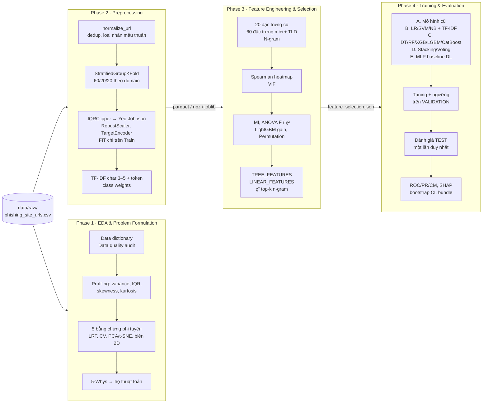

# Phishing URL Detection: ML Pipeline tái cấu trúc (`notebooks_new/`)

Hệ thống phát hiện URL lừa đảo (phishing) và độc hại **chỉ từ chuỗi URL**, offline, dưới 1 ms/URL, dùng **Machine Learning truyền thống**. Thư mục này là phiên bản tái cấu trúc theo chuẩn MLOps của dự án. Thư mục [`notebooks/`](../notebooks/) cũ được **giữ nguyên** để đối chiếu.

## Kết quả chính (Test, 100,307 URL thuộc **domain chưa từng thấy**)

| Mô hình | Vai trò | PR-AUC | ROC-AUC | F1 | Recall@FPR≤1% | FP | FN |
|---|---|:-:|:-:|:-:|:-:|--:|--:|
| XGBoost tuned, 20 đặc trưng cũ (NB05) | Mô hình cũ (baseline) | 0.877 | 0.946 | 0.770 | 0.585 | 2,568 | 6,518 |
| MLP 256-128-64 | Baseline Deep Learning | 0.908 | 0.958 | 0.813 | 0.707 | 810 | 6,307 |
| LightGBM + Optuna (52 đặc trưng mới) | Boosting tốt nhất | 0.926 | 0.968 | 0.850 | 0.751 | 1,217 | 4,762 |
| LR + TF-IDF char/token | Tuyến tính tốt nhất | 0.979 | 0.993 | 0.924 | 0.868 | 1,339 | 1,936 |
| **Stacking (TF-IDF LR+NB → LightGBM)** | **ML cải tiến, triển khai** | **0.986** | **0.995** | **0.933** | **0.904** | **872** | 1,951 |

So với mô hình cũ, **số phishing lọt qua giảm 70.1%** và **số lần chặn nhầm giảm 66.0%**. Khoảng tin cậy bootstrap 95% của F1 không giao nhau ([0.931, 0.936] so với [0.766, 0.775]). Bảng đầy đủ 15 mô hình nằm ở `artifacts/reports/phase4_test_results.csv`.

---

## 1. Kiến trúc dự án

```
phishing-url-detection/
├── data/raw/phishing_site_urls.csv        # Dataset gốc (Kaggle, 549,346 URL) – đầu vào duy nhất
├── notebooks/                             # ⛔ Phiên bản CŨ (01–06), giữ nguyên để đối chiếu
├── notebooks_new/                         # ✅ Phiên bản MỚI (4 phase độc lập)
│   ├── 01_eda_and_problem_formulation.ipynb
│   ├── 02_preprocessing_and_data_cleaning.ipynb
│   ├── 03_feature_engineering_and_selection.ipynb
│   ├── 04_model_training_and_evaluation.ipynb
│   ├── requirements.txt
│   └── README.md
├── src/
│   ├── features/                          # ⛔ Hàm đặc trưng CŨ (chỉ dùng để tái lập baseline)
│   └── phishing_ml/                       # ✅ Thư viện dùng chung cho notebooks_new/
│       ├── config.py                      #    đường dẫn, seed, thư mục artifacts
│       ├── features.py                    #    normalize_url + 60 đặc trưng (registry tường minh)
│       ├── preprocessing.py               #    IQRClipper (Winsorizing có chốt an toàn)
│       └── evaluation.py                  #    metrics, chọn ngưỡng, bootstrap CI, biểu đồ
└── artifacts/                             # Sinh tự động, được .gitignore (trừ reports/)
    ├── data/          {train,val,test}_{raw,scaled,legacy}.parquet, *_tfidf.npz
    ├── transformers/  preprocessor.joblib, tfidf_{char,word}.joblib, tfidf_chi2_selector.joblib
    ├── models/        phishing_detector.joblib (pipeline inference hoàn chỉnh)
    └── reports/       phase{1..4}_*.csv / *.json (bảng số liệu của từng phase)
```

### Luồng xử lý qua 4 phase



| Phase | Notebook | Câu hỏi trả lời | Đầu ra chính |
|:-:|---|---|---|
| 1 | `01_eda_and_problem_formulation` | Dữ liệu có vấn đề gì? Bản chất tuyến tính hay phi tuyến? Nên dùng họ thuật toán nào? | `reports/phase1_*` |
| 2 | `02_preprocessing_and_data_cleaning` | Làm sạch, chia tập và chuẩn hóa thế nào để **không rò rỉ**? | `data/*_{raw,scaled}.parquet`, `*_tfidf.npz`, `transformers/*` |
| 3 | `03_feature_engineering_and_selection` | Đặc trưng nào mang thông tin, đặc trưng nào dư thừa hoặc đa cộng tuyến? | `reports/phase3_feature_selection.json`, `data/*_legacy.parquet` |
| 4 | `04_model_training_and_evaluation` | Mô hình nào tốt nhất trên **domain chưa thấy**? Vì sao? | `models/phishing_detector.joblib`, `reports/phase4_*` |

---

## 2. Cài đặt môi trường

**Yêu cầu:** Python **≥ 3.11** (đã kiểm thử trên 3.14.4), RAM ≥ 8 GB (khuyến nghị 16 GB), khoảng 1 GB dung lượng trống cho `artifacts/`.

> Mọi lệnh dưới đây chạy từ **thư mục gốc dự án** (`phishing-url-detection/`).

### 2.1. macOS / Linux (Terminal)

```bash
# 1) Tạo và kích hoạt môi trường ảo
python3 -m venv venv
source venv/bin/activate

# 2) Cài đặt thư viện
python -m pip install --upgrade pip
pip install -r notebooks_new/requirements.txt

# 3) Đăng ký kernel Jupyter cho môi trường này
python -m ipykernel install --user --name phishing-ml --display-name "Python (phishing-ml)"
```

#### ⚠️ macOS Apple Silicon (M1/M2/M3/M4): lỗi `libomp` với XGBoost / LightGBM

XGBoost và LightGBM cần thư viện OpenMP. Nếu `import xgboost` báo lỗi kiểu:

```
XGBoostError: XGBoost Library (libxgboost.dylib) could not be loaded.
  ... Library not loaded: @rpath/libomp.dylib ...
```
hoặc `OSError: dlopen(... lib_lightgbm.dylib ...): Library not loaded: ... libomp.dylib`, hãy xử lý như sau:

```bash
# Cài OpenMP qua Homebrew
brew install libomp

# Kiểm tra lại
python -c "import xgboost, lightgbm; print(xgboost.__version__, lightgbm.__version__)"
```

Nếu vẫn lỗi, Homebrew trên Apple Silicon cài vào `/opt/homebrew` (không phải `/usr/local`), nên trình nạp thư viện có thể không tìm thấy `libomp`. Khai báo đường dẫn rồi cài lại:

```bash
export LDFLAGS="-L/opt/homebrew/opt/libomp/lib"
export CPPFLAGS="-I/opt/homebrew/opt/libomp/include"
export DYLD_LIBRARY_PATH="/opt/homebrew/opt/libomp/lib:$DYLD_LIBRARY_PATH"
pip install --force-reinstall --no-cache-dir xgboost lightgbm
```

Một số lưu ý khác:
- Đảm bảo Python và Homebrew cùng kiến trúc **arm64**: `python -c "import platform; print(platform.machine())"` phải in `arm64`. Nếu in `x86_64`, bạn đang chạy Python qua Rosetta. Hãy cài lại Python bản arm64.
- Dùng **conda** thì đơn giản hơn: `conda install -c conda-forge xgboost lightgbm`, vì conda-forge tự kéo `llvm-openmp`.

### 2.2. Windows

**PowerShell:**
```powershell
# 1) Tạo môi trường ảo
py -3 -m venv venv

# 2) Kích hoạt (nếu bị chặn script, chạy trước lệnh dưới đây một lần)
#    Set-ExecutionPolicy -Scope CurrentUser -ExecutionPolicy RemoteSigned
.\venv\Scripts\Activate.ps1

# 3) Cài đặt
python -m pip install --upgrade pip
pip install -r notebooks_new\requirements.txt
python -m ipykernel install --user --name phishing-ml --display-name "Python (phishing-ml)"
```

**CMD:**
```bat
py -3 -m venv venv
venv\Scripts\activate.bat
python -m pip install --upgrade pip
pip install -r notebooks_new\requirements.txt
python -m ipykernel install --user --name phishing-ml --display-name "Python (phishing-ml)"
```

> **Windows:** nếu `pip install` lỗi khi build `catboost` hoặc `lightgbm`, hãy kiểm tra đang dùng Python **64-bit** (`python -c "import struct; print(struct.calcsize('P')*8)"` phải in `64`) và cài [Microsoft Visual C++ Redistributable](https://learn.microsoft.com/cpp/windows/latest-supported-vc-redist). Các gói này đều có wheel dựng sẵn cho Windows x64.

### 2.3. Conda (mọi hệ điều hành)

```bash
conda create -n phishing-ml python=3.12 -y
conda activate phishing-ml
conda install -c conda-forge xgboost lightgbm catboost -y      # kéo sẵn OpenMP
pip install -r notebooks_new/requirements.txt
python -m ipykernel install --user --name phishing-ml --display-name "Python (phishing-ml)"
```

### 2.4. Kiểm tra cài đặt

```bash
python -c "import sklearn, xgboost, lightgbm, catboost, shap, optuna, tldextract; print('OK', sklearn.__version__)"
```

---

## 3. Chạy pipeline

### 3.1. Thứ tự bắt buộc

Các notebook **phụ thuộc tuần tự** qua `artifacts/`, nên phải chạy đúng thứ tự:

| Bước | Notebook | Cần có trước | Thời gian ước tính* |
|:-:|---|---|:-:|
| 1 | `01_eda_and_problem_formulation.ipynb` | `data/raw/phishing_site_urls.csv` | ~1.5 phút |
| 2 | `02_preprocessing_and_data_cleaning.ipynb` | dataset gốc | ~10 phút |
| 3 | `03_feature_engineering_and_selection.ipynb` | artifacts của Phase 2 | <!-- T3 --> |
| 4 | `04_model_training_and_evaluation.ipynb` | artifacts của Phase 2 + 3 | <!-- T4 --> |

\* Đo trên MacBook Apple Silicon 8 nhân, 16 GB RAM. Phase 1 độc lập (chỉ đọc dữ liệu gốc), nên có thể bỏ qua nếu chỉ cần mô hình.

**Cách 1: JupyterLab (tương tác)**
```bash
jupyter lab notebooks_new/
```
Chọn kernel **Python (phishing-ml)**, mở từng notebook theo thứ tự rồi chọn *Run → Run All Cells*.

**Cách 2: Chạy headless (tái lập toàn bộ)**
```bash
cd notebooks_new
for nb in 01_*.ipynb 02_*.ipynb 03_*.ipynb 04_*.ipynb; do
  jupyter nbconvert --to notebook --execute --inplace \
      --ExecutePreprocessor.kernel_name=phishing-ml \
      --ExecutePreprocessor.timeout=7200 "$nb"
done
```
Trên Windows PowerShell:
```powershell
cd notebooks_new
Get-ChildItem 0*.ipynb | Sort-Object Name | ForEach-Object {
  jupyter nbconvert --to notebook --execute --inplace `
      --ExecutePreprocessor.kernel_name=phishing-ml --ExecutePreprocessor.timeout=7200 $_.Name }
```

Mỗi notebook tự dò thư mục gốc dự án, nên chạy từ thư mục gốc hay từ `notebooks_new/` đều được. Mọi thao tác ngẫu nhiên dùng `RANDOM_STATE = 42`, nên kết quả tái lập được.

### 3.2. Dùng mô hình đã huấn luyện (inference)

Hàm `predict_urls()` được định nghĩa và kiểm thử ở cuối Phase 4 (§13). Bundle `artifacts/models/phishing_detector.joblib` chứa toàn bộ chuỗi xử lý: chuẩn hóa URL → đặc trưng → TF-IDF → level-0 → meta-model → ngưỡng chặn/cảnh báo. Vì cùng một code path với lúc train, inference **không có train/serve skew**: `google.com`, `https://www.google.com/` và `HTTPS://WWW.Google.com/` nhận **cùng một xác suất**.

---

## 4. Các khắc phục kỹ thuật so với phiên bản cũ

| # | Thiếu sót của `notebooks/` cũ | Hậu quả | Khắc phục trong `notebooks_new/` | Phase |
|:-:|---|---|---|:-:|
| 1 | Không chuẩn hóa URL; khử trùng lặp theo chuỗi nguyên văn | Shortcut "không có `/` ⇒ phishing" (98.6%); `google.com` bị chấm 96.8% phishing; ~5,600 bản gần trùng | `normalize_url()` dùng chung cho train và inference; khử trùng lặp **sau** chuẩn hóa | 2 |
| 2 | Chia ngẫu nhiên theo dòng | **76.1%** URL test có domain đã thấy trong train, nên kết quả lạc quan | `StratifiedGroupKFold` theo registered domain, **60/20/20**, 0 domain chung | 2 |
| 3 | Chọn mô hình và đọc kết quả trên cùng tập test | Selection bias | Train / **Validation** / Test riêng; tuning, early stopping, ngưỡng, trọng số ensemble đều chọn trên Validation; Test chạy **một lần** | 2, 4 |
| 4 | Không scaling; LR hội tụ kém | LR underfit (Recall 0.45) | IQRClipper → Yeo-Johnson / RobustScaler, **fit chỉ trên Train**; nhánh cây dùng giá trị gốc | 2 |
| 5 | Không xử lý mất cân bằng; ngưỡng 0.5 cố định | Bỏ sót ~24–30% phishing | Class weights / `scale_pos_weight`; ngưỡng tối ưu F1 chọn trên Validation; chính sách 2 ngưỡng theo FPR | 2, 4 |
| 6 | Đặc trưng chết (`has_https`, WHOIS = −1); auto-discovery nhặt nhầm `ensure_scheme` | Schema mong manh, nhiễu | Registry tường minh `FEATURE_GROUPS`; loại hằng số trên Train | 3 |
| 7 | `count_sensitive_words` khớp chuỗi con, không phân biệt vị trí | `pineapple` khớp `apple`, `gobankingrates.com` bị chấm 99.4% | So khớp **theo ranh giới từ**, tách host/path; đặc trưng brand-in-domain vs brand-out-of-domain | 3 |
| 8 | Chỉ 20 đặc trưng đếm, không có biểu diễn chuỗi | 23% URL có vector mơ hồ | 60 đặc trưng bảo mật + TLD target-encoding + TF-IDF char 3–5 (χ²-selected) | 2, 3 |
| 9 | Không phân tích đa cộng tuyến hay tầm quan trọng một cách hệ thống | Hệ số LR không ổn định | Spearman heatmap, **VIF**, MI, ANOVA F/χ², LightGBM gain, permutation; tập riêng cho cây và tuyến tính | 3 |
| 10 | Chỉ LR / RF / XGBoost; RandomizedSearchCV 15 cấu hình, tối ưu F1 | Chạm biên không gian tìm kiếm | + LinearSVC, ComplementNB, DT, LightGBM, CatBoost, Stacking, Voting; Optuna TPE tối ưu **PR-AUC** | 4 |
| 11 | Chỉ báo cáo Accuracy/F1 | Accuracy 0.78 đạt được bằng cách "luôn cho qua" | PR-AUC (metric chính), ROC-AUC, Recall@FPR≤1%, Brier, bootstrap CI 95% | 4 |
| 12 | Không giải thích mô hình; không lưu mô hình | Không truy vết được cảnh báo; phải chạy lại notebook | SHAP TreeExplainer; một bundle `joblib` duy nhất kèm `predict_urls()` | 4 |
| 13 | Không chứng minh lựa chọn thuật toán | Chọn theo thói quen | Phase 1 chứng minh phi tuyến bằng 5 bằng chứng (LRT p ≈ 0, paired t-test…) | 1 |
| 14 | Đường dẫn không nhất quán (`data/` vs `../data/`); `!pip install` trong notebook | Khó tái lập | Tự dò thư mục gốc; `requirements.txt` có phiên bản đã kiểm thử | Tất cả |

---

## 5. Ràng buộc và phạm vi

- **Chỉ ML truyền thống:** linear models, SVM, Naive Bayes, Decision Tree, Random Forest, XGBoost, LightGBM, CatBoost, Stacking/Voting. Mô hình Deep Learning **duy nhất** là `MLPClassifier`, đóng vai trò **baseline đối chiếu**. Không dùng LLM hay Transformer.
- **Chỉ phân tích chuỗi URL** (offline): không truy vấn WHOIS, DNS hay nội dung trang, nên phù hợp chặn real-time.
- **Hạn chế đã biết:** dataset cũ và đơn nguồn (có artefact thời gian như token năm `2011`/`2015`); nhãn có thiên lệch theo từ khóa. Trước khi triển khai thật cần kiểm thử trên feed mới (PhishTank, OpenPhish, URLhaus) theo **temporal split** và giám sát drift.
